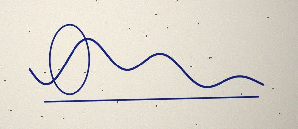
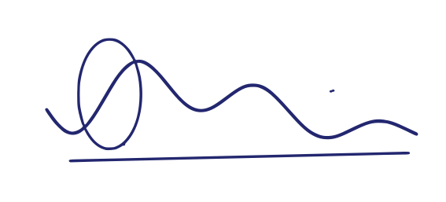
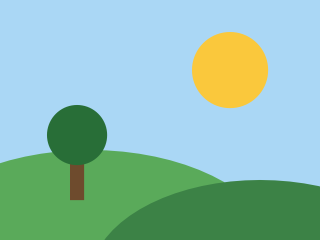
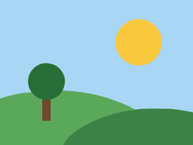
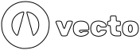

# vecto

Turn PNG, JPG and WebP images into clean, small SVGs, and find out how accurate each one is.

`vecto` traces logos, icons, signatures, line art, colour illustrations and pixel art. It also makes cut files for Cricut, Silhouette, laser cutters and plotters. You can use it as a **CLI**, a **Python library**, or an **MCP server** that AI assistants call directly.

- **Presets instead of knobs.** Pick `logo`, `signature`, `cut`, `pixel` and so on instead of tuning potrace settings.
- **Every result is scored.** vecto renders the SVG back to pixels and compares it with the source, so you can see how faithful the trace is.
- **`--auto` tuning.** It searches tracing settings for the *smallest* SVG that still matches the source.
- **Handles real inputs.** It deals with transparent PNGs, light-on-dark images, tiny low-resolution logos, phone photos of signatures and dusty scans.
- **No system dependencies.** Every dependency installs from pip wheels on Linux, macOS and Windows. You don't need the `potrace` binary or Cairo.

## Examples

| Input | Command | Output (SVG) |
| --- | --- | --- |
|  200×80 transparent PNG | `vecto convert logo.png -p logo --auto` | <br>3.0 KB · fidelity 98.3% · edge error 0.24 px |
|  phone photo, uneven light, dust | `vecto convert signature.jpg -p signature` | <br>3.3 KB · transparent · keeps the ink colour |
|  flat illustration | `vecto convert art.png -p color` | <br>2.3 KB · 6 colours · fidelity 99.6% |
|  16×16 sprite | `vecto convert pixel.png -p pixel` | <br>2.0 KB · pixel-exact |
|  | `vecto convert logo.png -p cut --outline` | <br>cut lines for a laser or plotter |

The example inputs are synthetic and generated by [`examples/make_examples.py`](examples/make_examples.py).

## Install

vecto needs Python 3.12 or newer.

```bash
uv tool install git+https://github.com/hugoogb/vecto
```

You can use pipx instead:

```bash
pipx install git+https://github.com/hugoogb/vecto
```

To use the MCP server, install the `mcp` extra:

```bash
uv tool install "vecto-svg[mcp] @ git+https://github.com/hugoogb/vecto"
```

The package is called `vecto-svg` because `vecto` is already taken on PyPI. The command is still `vecto`.

For development:

```bash
git clone https://github.com/hugoogb/vecto && cd vecto
uv sync --all-extras
uv run pytest
```

## Usage

### Convert one image

```bash
vecto convert input.png                  # writes input.svg
vecto convert input.png out.svg -p logo  # use a preset
vecto convert input.png --auto           # smallest SVG that still matches
vecto convert input.png --preview        # also writes out.preview.png
```

Each run prints a summary to stderr:

```
input.svg: 176.75x64, 3.0 KB, 1 paths, fidelity 98.3%, edge error 0.24px, 18 settings tried
```

### Pipes and scripts

Use `-` for stdin or stdout. Add `--json` to get machine-readable results.

```bash
curl -s https://example.com/logo.png | vecto convert - -p logo > logo.svg
vecto convert logo.png logo.svg --json | jq '.fidelity, .bytes'
```

### Convert a folder

`batch` accepts every `convert` option. Without `--jobs` it uses one worker per CPU. One broken file doesn't stop the batch: failures are listed at the end, and the exit code is non-zero if any file failed.

```bash
vecto batch ./images ./svgs -p icon --recursive --jobs 8
vecto batch ./scans ./out -p signature --skip-existing --json > report.json
```

### Presets

Run `vecto presets` to list them:

| Preset | For |
| --- | --- |
| `logo` | Flat logos and wordmarks. Keeps the ink colour, smooth curves, tight crop. |
| `icon` | Small icons and glyphs. Upscales aggressively before tracing. |
| `signature` | Scanned or photographed signatures and handwriting. Handles uneven paper, removes dust, transparent background. |
| `lineart` | Ink drawings, sketches and comics in black and white. |
| `cut` | Cutting machines (Cricut, Silhouette, laser, plotter). One colour, no specks, simplified paths. Add `--outline` for stroke-only cut lines. |
| `color` | Colour illustrations, flat artwork and stickers. |
| `photo` | Photographs, with a posterised look. |
| `pixel` | Pixel art. Keeps hard square pixels. |

Any option you set overrides the preset. For example, `-p cut --turdsize 5` keeps smaller details.

### Fidelity and `--auto`

After tracing, vecto renders the SVG and compares it with the source.

- **Mono** results get two numbers:
  - **fidelity** is the intersection-over-union of the ink pixels. Unlike plain pixel accuracy, it isn't inflated by empty background. Specks that were removed on purpose (see `--turdsize`) don't count against it.
  - **edge error** is how far the outlines drift from the source, in pixels (99th percentile). Area scores barely notice rounded corners, but edge error does.
- **Colour** results get one number: 1 minus the mean colour difference.

`--auto` tries different curve-fitting settings (`alphamax` and `opttolerance` for mono, `colors` and `layer_difference` for colour). It keeps the **smallest file** that meets `--target` (default 0.95 mono, 0.98 colour) and, for mono, `--max-edge` (default 0.5 px). If no setting qualifies, it returns the most faithful result with a warning. Noise filtering is never auto-tuned. A search that rewards fidelity would always choose to keep the dust.

### Use from Python

```python
from vecto import vectorize, build_options

result = vectorize("logo.png", build_options("logo"), auto=True)
print(result.fidelity, result.edge_error, result.bytes)
open("logo.svg", "w").write(result.svg)

# numpy arrays (RGB, RGBA or greyscale) and raw bytes work too
result = vectorize(image_array, build_options("cut", turdsize=10))
```

### Use from AI assistants (MCP)

`vecto mcp` starts a stdio MCP server with two tools: `vectorize_image` and `list_presets`. The tool returns fidelity, size and warnings, so an agent can check the result instead of guessing.

To add it to Claude Code:

```bash
claude mcp add vecto -- uvx --from "vecto-svg[mcp] @ git+https://github.com/hugoogb/vecto" vecto mcp
```

For Claude Desktop, Cursor and other MCP clients, add this to the MCP config:

```json
{
  "mcpServers": {
    "vecto": {
      "command": "uvx",
      "args": ["--from", "vecto-svg[mcp] @ git+https://github.com/hugoogb/vecto", "vecto", "mcp"]
    }
  }
}
```

## Options

| Option | Default | Description |
| --- | --- | --- |
| `-p, --preset` | none | Start from a preset (see above). |
| `-m, --mode` | `mono` | `mono` traces one colour with potrace. `color` traces colour layers with vtracer. |
| `--auto` | off | Search for the smallest SVG that meets `--target` and `--max-edge`. |
| `--target` | 0.95 / 0.98 | Fidelity goal for `--auto`. |
| `--max-edge` | 0.5 | [mono] Maximum edge drift for `--auto`, in pixels. |
| `-t, --threshold` | auto (Otsu) | Cut-off between ink and background (0–255). |
| `--adaptive` | off | Local thresholding, for shadows and uneven paper. |
| `--invert / --no-invert` | auto | Swap ink and background. By default, dark backgrounds are detected automatically. |
| `--blur` | 3 | Denoising blur before thresholding (0 turns it off). |
| `-u, --upscale` | auto | Enlarge the image before tracing. By default, small anti-aliased mono images are upscaled up to 4×. |
| `--crop / --no-crop` | off | Trim empty margins. |
| `--padding` | 0 | Margin kept around cropped content, in pixels. |
| `-c, --color` | `auto` | Mono fill colour. `auto` keeps the source's ink colour. |
| `-b, --background` | none | Add a solid background. Output is transparent by default. |
| `--outline / --fill` | fill | Draw strokes instead of filled shapes. |
| `--stroke-width` | 1 | Stroke width for `--outline`, in pixels. |
| `--turdsize` | 5 | [mono] Remove specks up to this area, in pixels. |
| `--alphamax` | 0.9 | [mono] Corner smoothing, from 0 (sharp) to 1.334 (round). |
| `--opttolerance` | 0.2 | [mono] How aggressively curves are merged. |
| `--colors` | 6 | [color] Colour precision in bits per channel (1–8). |
| `--filter-speckle` | 4 | [color] Discard patches smaller than this. |
| `--layer-difference` | 16 | [color] Minimum colour difference between layers. |
| `--trace-mode` | `spline` | [color] `spline`, `polygon`, or `none` (pixel-exact). |
| `--optimize / --no-optimize` | on | Minify the SVG with Scour. |
| `--preview` | off | Also write a PNG rendering of the result. |
| `--json` | off | Print machine-readable results. |
| `-q, --quiet` | off | Only print errors. |

## How it works

1. **Load.** Pillow reads the image, with EXIF rotation, 16-bit images and transparency all handled. Transparent images are composited onto whichever background contrasts with the content, so both dark and light logos on transparency come out right.
2. **Prepare (mono).** vecto converts to greyscale and upscales small images, but only anti-aliased ones, where there's sub-pixel detail to recover. It then blurs lightly, thresholds (Otsu, manual or adaptive), detects a dark background, and optionally crops.
3. **Trace.** Mono images go through potrace (pure-Python [`potracer`](https://pypi.org/project/potracer/)). Colour images go through [`vtracer`](https://github.com/visioncortex/vtracer).
4. **Optimise.** [Scour](https://github.com/scour-project/scour) minifies the SVG. The output keeps the source's pixel dimensions, plus a `viewBox`.
5. **Score.** [resvg](https://github.com/linebender/resvg) renders the result, which is compared against the source (see *Fidelity* above).

## License

[MIT](LICENSE)
